 

🏅 CHPC National Finalist 2025 &amp; 2026 &nbsp;·&nbsp; 🖥️ Captain, Team 3NCRYP+3D &nbsp;·&nbsp; 🚀 Founder, saxsprojects

 

## What I Do

Software engineer with an Advanced Diploma in Information and Communication Technology (ICT) in Application Development (ADPICT) from the University of Mpumalanga. I build full-stack products and the infrastructure underneath them. My work spans high-performance computing, AI and computer-vision MVPs, and education and fintech apps aimed at real South African problems: university admissions, primary-school learning, local-market payments, road safety and service delivery. I run saxsprojects, my software studio, and I tutor and lead students on the side. I care about shipping things that actually work, with real tests and real deployments behind them.

 

## 🌟 Featured Projects

<table>
<tr>
<td width="50%" valign="top">

### 🎓 UCAG
**University Course & APS Guide**

Helps South African matriculants calculate their APS and match it against real admission rules and courses at institutions such as UP, Wits, NWU, NMU, UKZN, TUT and Stellenbosch, including multi-campus offerings and bursaries.

`Next.js` `TypeScript` `Firebase` `GitHub Actions`

</td>
<td width="50%" valign="top">

### 💳 Ukhona Pay
**QR Payments for Local Markets**

Fintech QR-payment platform for traders and shoppers in Mbombela/Nelspruit, built for the EDHE Hackathon 2026 Market Connectivity challenge.

`JavaScript` `Cloud Run` `Vercel`

</td>
</tr>
<tr>
<td width="50%" valign="top">

### 🧒 QuestKids
**Gamified CAPS Learning App**

Educational game app for Grade 1-7 learners with Learner, Parent and Teacher roles, 140+ curriculum-aligned games, and AI features routed through Cloud Functions so no keys ship to the device.

`Flutter` `Dart` `Firebase` `Cloud Functions`

</td>
<td width="50%" valign="top">

### 🌺 Protea OS
**Cross-Device Operating System**

A long-term OS project with a shared Rust core, a GTK4 desktop shell on Linux, an Android launcher heading toward AOSP, and a Buildroot pipeline that produces a bootable x86_64 image tested in QEMU through CI.

`Rust` `GTK4` `Android` `Buildroot`

</td>
</tr>
</table>

### 👁️ AI/IoT Computer-Vision Suite

Ten full-stack MVPs, each with a FastAPI backend on Google Cloud Run and a React frontend on Vercel. Five use MobileNetV2 models I trained with transfer learning (fire/smoke detection reaches 94.8% validation accuracy).

[SafeSpeed AI](https://github.com/saxs-14/safespeed-ai) · [PotholeWatch](https://github.com/saxs-14/potholewatch) · [FireWatch AI](https://github.com/saxs-14/firewatch-ai) · [PPE Guardian](https://github.com/saxs-14/ppe-guardian) · [SmartWaste AI](https://github.com/saxs-14/smartwaste-ai) 
[AgriVision](https://github.com/saxs-14/agrivision) · [WaterGuard AI](https://github.com/saxs-14/waterguard-ai) · [EnergyWatch](https://github.com/saxs-14/energywatch) · [QueueSense](https://github.com/saxs-14/queuesense) · [FaceGate](https://github.com/saxs-14/facegate)

`Python` `OpenCV` `PyTorch` `FastAPI` `React` `Cloud Run`

 

## 🖥️ High-Performance Computing

**CHPC Student Cluster Competition** · Team 3NCRYP+3D, University of Mpumalanga

- **HPL tuning:** pushed a 2-node OpenStack cluster to **1,025 GFLOPS (83.7% of theoretical peak)** by moving from OpenBLAS to Intel MKL with AVX-512 and tuning problem size, block size and broadcast algorithm.
- **Benchmarks:** HPL, HPCC, HPCG and OpenMX builds with multi-node MPI runs.
- **Platform engineering:** Kubernetes with Cilium networking, Argo CD GitOps, Sealed Secrets, Cinder storage, WireGuard access and Wazuh security monitoring, managed through Terraform and reviewed pull requests.
- **Research interest:** GPU acceleration of SPUMA/OpenFOAM.

 

## 📁 See More Projects

**Web & Mobile:** UCAG · Ukhona Pay · QuestKids · Tshinanne Transport · Grocery Tracker Pro 
**Systems & Infra:** Protea OS · CHPC cluster work 
**AI / Computer Vision:** SafeSpeed · PotholeWatch · FireWatch · AgriVision · and more

 

## 🛠️ Tech Stack

  

**Frontend:** React · Next.js · Vite · Flutter &nbsp;|&nbsp; **Backend:** FastAPI · Node.js · Firebase Cloud Functions 
**AI / CV:** PyTorch · OpenCV · MobileNetV2 · Gemini API &nbsp;|&nbsp; **Cloud:** Google Cloud Run · Vercel · Firebase 
**HPC & DevOps:** OpenMPI · Intel MKL · Kubernetes · Cilium · Argo CD · Terraform · GitHub Actions

 

## 🏆 Competitions & Recognition

| | |
|---|---|
| 🏅 **National Finalist, CHPC Student Cluster Competition 2025** | Centre for High Performance Computing national round |
| 🏅 **National Finalist, CHPC Student Cluster Competition 2026** | Centre for High Performance Computing national round |
| 🖥️ **Team Captain, CHPC SCC 2026** | Leading Team 3NCRYP+3D (University of Mpumalanga) |
| 💡 **EDHE Hackathon 2026** | Built Ukhona Pay for the Market Connectivity challenge |
| 🎓 **Tutor & Student Leader** | University of Mpumalanga |

 

## 📊 GitHub Activity

 

### 📫 Let's Build Something

© 2026 Phathutshedzo Mamagau

